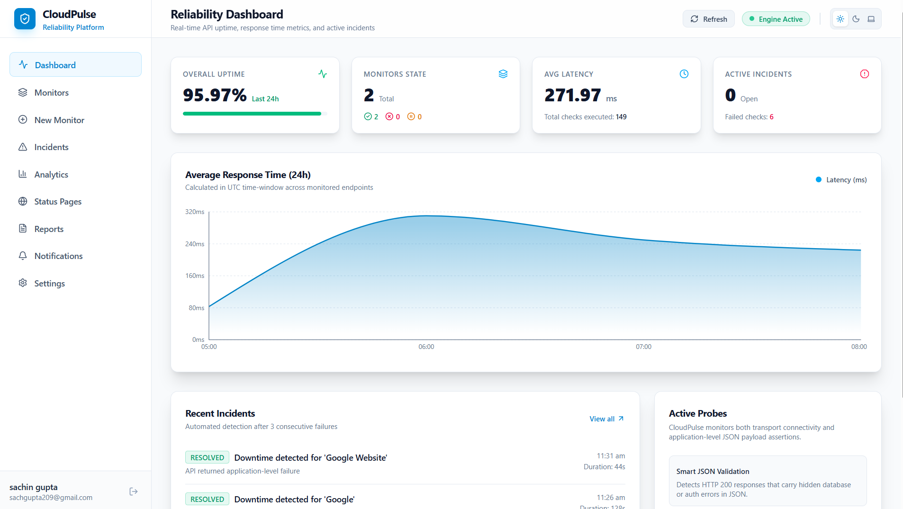
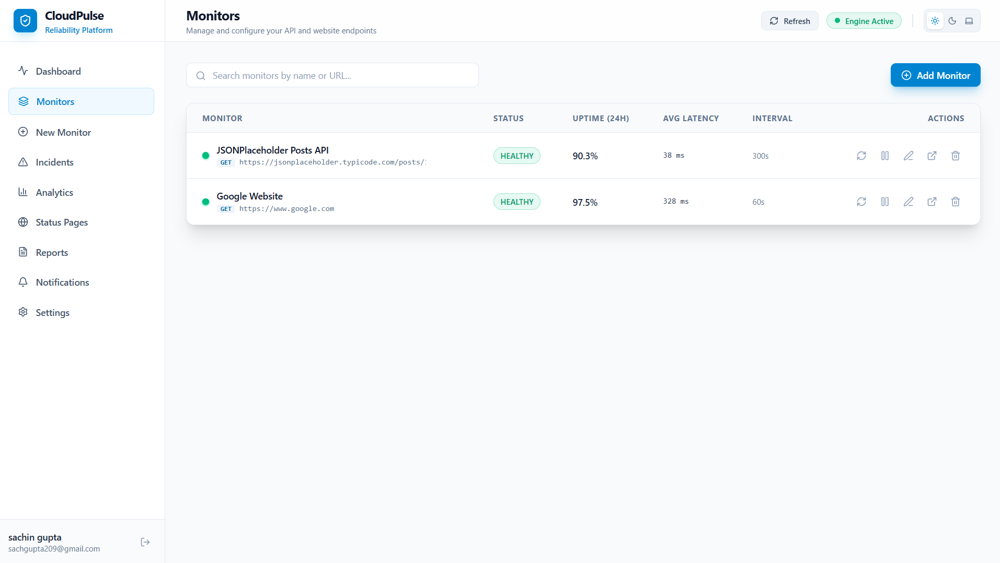
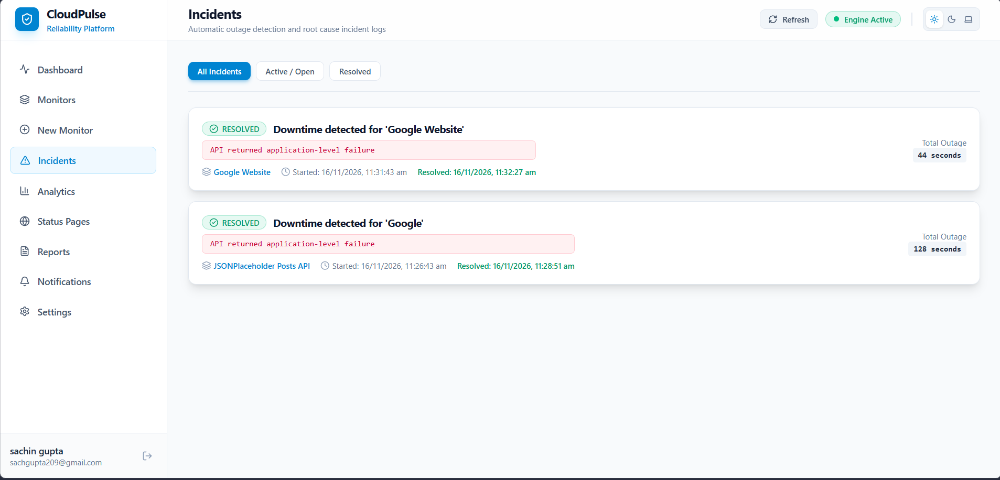
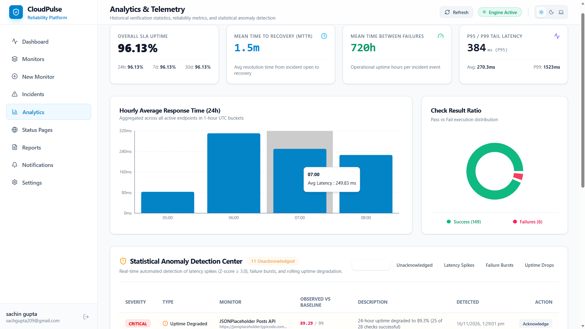

# CloudPulse – API Reliability & Smart Health Validation Platform


**CloudPulse** is a full-stack website and API reliability monitoring platform designed to monitor service availability, validate API responses, detect failures, track incidents, and analyze application performance.

Unlike basic uptime monitoring, CloudPulse can identify application-level failures even when an API returns HTTP 200 OK.

---

## Table of Contents

- Overview
- Problem Statement
- Key Features
- Architecture
- Technology Stack
- How It Works
- Smart API Validation
- REST API Endpoints
- Database Design
- Security
- Getting Started
- Testing
- Future Enhancements

---

## 1. Overview

Traditional uptime monitoring systems primarily check whether a website or API responds successfully.

However, an API can return HTTP 200 OK while its response contains an application-level error.

CloudPulse addresses this limitation through configurable response validation, scheduled health checks, incident management, and reliability analytics.

It provides a centralized dashboard to monitor multiple websites and APIs from one platform.

## 2. Problem Statement

Traditional monitoring tools may fail to identify:

- APIs returning HTTP 200 with incorrect application data.
- Missing or invalid JSON response fields.
- Slow API responses.
- Repeated service failures.
- Unexpected changes in service availability.

**Our Solution:** CloudPulse combines HTTP monitoring with smart response validation and incident tracking to provide deeper visibility into service health.

---

## 3. Key Features

### Authentication and Security
- User registration and login.
- JWT-based authentication.
- Refresh token management.
- BCrypt password hashing.
- User-level resource isolation.

### Website and API Monitoring
- Monitor multiple websites and APIs.
- Support HTTP methods such as GET, POST, PUT, PATCH, DELETE and HEAD.
- Configure monitoring intervals and timeouts.
- Custom request headers and request bodies.
- Pause, resume and manually trigger checks.

### Smart API Validation
- HTTP status validation.
- Response-time and SLA validation.
- JSON syntax validation.
- JSONPath field existence checks.
- JSONPath value comparison.
- HTTP response header validation.

### Incident Management
- Detect consecutive monitoring failures.
- Automatically create incidents after repeated failures.
- Track downtime and recovery.
- Prevent duplicate open incidents.
- Acknowledge detected anomalies.

### Dashboard and Analytics
- Overall service health.
- Uptime monitoring.
- Response-time trends.
- Incident history.
- P95 and P99 latency.
- MTTR and MTBF metrics.
- Statistical anomaly detection.

### Notifications and Reports
- Transactional notification outbox.
- Retry processing for failed notifications.
- Mailpit integration for local email testing.
- PDF monitoring reports.
- Public status pages.

### Additional Capabilities
- Light, Dark and System themes.
- SSRF protection.
- Rate limiting.
- Scheduled monitoring using Spring Scheduler.
- Distributed scheduling locks using ShedLock.

---

## 4. System Architecture

```text
             CLIENT / BROWSER
                    |
                    v
          REACT + TYPESCRIPT
                    |
                    v
             AXIOS REQUEST
                    |
                    v
          SPRING BOOT REST APIs
                    |
          SPRING SECURITY + JWT
                    |
          +---------+----------+
          |         |          |
          v         v          v
       Monitor  Validation  Analytics
      Management  Engine     Engine
          |         |          |
          +---------+----------+
                    |
                    v
            SCHEDULED CHECKS
             SPRING SCHEDULER
                    |
                    v
              JAVA HTTP CLIENT
                    |
                    v
          EXTERNAL WEBSITES/APIs
                    |
                    v
           RESPONSE VALIDATION
                    |
                    v
              POSTGRESQL
                    |
          +---------+----------+
          |         |          |
          v         v          v
       Dashboard Incidents Notifications
          |
          v
       Analytics & Reports
```

---

## 5. Technology Stack

| Layer | Technologies |
|---|---|
| Programming Language | Java 21 |
| Backend Framework | Spring Boot |
| Security | Spring Security, JWT, BCrypt |
| Frontend | React, TypeScript, Vite |
| UI Styling | Tailwind CSS |
| HTTP Client | Axios, Java HTTP Client |
| Database | PostgreSQL |
| ORM | Spring Data JPA, Hibernate |
| Database Migration | Flyway |
| JSON Validation | Jayway JsonPath |
| Scheduling | Spring Scheduler, ShedLock |
| PDF Generation | OpenPDF |
| Charts | Recharts |
| Build Tool | Maven |
| Containerization | Docker, Docker Compose |
| CI | GitHub Actions |
| Email Testing | Mailpit |

---

## 6. How CloudPulse Works

1. The user registers and logs into CloudPulse.
2. The user adds a website or API monitor.
3. The backend validates and stores monitor configuration.
4. Spring Scheduler identifies monitors that are due for checking.
5. Java HTTP Client sends an HTTP request to the target.
6. The Validation Engine checks status, response time, headers and JSON data.
7. Monitoring results are stored in PostgreSQL.
8. Repeated failures can generate incidents.
9. Recovery checks can automatically resolve incidents.
10. The dashboard displays monitoring results and analytics.

---

## 7. Smart API Validation Example

Consider an API that returns:

```json
{
  "status": "error",
  "message": "Database connection failed"
}
```

The HTTP response status might still be:

```http
HTTP/1.1 200 OK
```

A basic uptime checker may consider this request successful.

CloudPulse can use a JSONPath rule:

```text
Target: $.status
Expected Value: success
```

Since the actual value is `error`, CloudPulse identifies an application-level failure.

This is one of the important capabilities of the platform.

---

## 8. REST API Endpoint Reference

### Authentication

| Method | Endpoint | Description |
|---|---|---|
| POST | /api/auth/register | Register user |
| POST | /api/auth/login | Authenticate user |
| POST | /api/auth/refresh | Refresh access token |
| GET | /api/auth/me | Get current user |

### Monitor Management

| Method | Endpoint | Description |
|---|---|---|
| GET | /api/monitors | List monitors |
| POST | /api/monitors | Create monitor |
| GET | /api/monitors/{id} | Get monitor |
| PUT | /api/monitors/{id} | Update monitor |
| DELETE | /api/monitors/{id} | Delete monitor |
| POST | /api/monitors/{id}/check | Trigger manual check |
| POST | /api/monitors/{id}/pause | Pause monitor |
| POST | /api/monitors/{id}/resume | Resume monitor |

### Analytics and Anomalies

| Method | Endpoint | Description |
|---|---|---|
| GET | /api/analytics/dashboard | Dashboard analytics |
| GET | /api/analytics/advanced | Advanced reliability metrics |
| GET | /api/anomalies | List anomalies |
| POST | /api/anomalies/{id}/acknowledge | Acknowledge anomaly |

### Notifications

| Method | Endpoint | Description |
|---|---|---|
| GET | /api/notifications/preferences | Get preferences |
| PUT | /api/notifications/preferences | Update preferences |
| GET | /api/notifications/history | View notification history |
| POST | /api/notifications/test | Test notification |

### Public Status Pages

| Method | Endpoint | Description |
|---|---|---|
| GET | /api/status-pages | List status pages |
| POST | /api/status-pages | Create status page |
| PATCH | /api/status-pages/{id}/publish | Publish status page |
| GET | /api/public/status/{slug} | View public status |

### PDF Reports

| Method | Endpoint | Description |
|---|---|---|
| GET | /api/reports/monitors/{id}/pdf | Monitor SLA report |
| GET | /api/reports/summary/pdf | Portfolio report |
| GET | /api/reports/incidents/pdf | Incident report |
| GET | /api/reports/performance/pdf | Performance report |

---

## 9. Database Design

CloudPulse uses PostgreSQL for persistent storage.

Main database entities include:

- Users
- Refresh Tokens
- Monitors
- Validation Rules
- Check Results
- Incidents
- Notification Preferences
- Notification History
- Status Pages
- Anomalies
- ShedLock

**Flyway** manages version-controlled database schema migrations.

---

## 10. Security Implementation

Security is an important part of CloudPulse.

Implemented security mechanisms include:

- JWT-based authentication.
- BCrypt password hashing.
- Spring Security.
- User-level resource isolation.
- Request validation.
- Rate limiting.
- SSRF protection.
- Private IP and cloud metadata address restrictions.
- HTTP redirect destination validation.
- Response body size limits.

### What is SSRF protection?

SSRF stands for Server-Side Request Forgery.

CloudPulse accepts URLs for monitoring. An attacker could attempt to make the backend send requests to internal or restricted resources.

SSRF protection validates target URLs and blocks unsafe destinations.

---

## 11. Getting Started

### Prerequisites

Install:

- Java 21
- Maven
- Node.js and npm
- PostgreSQL
- Docker Desktop

### Clone the Repository

```bash
git clone https://github.com/Sachingupta209/cloudpulse-api-reliability-platform.git

cd cloudpulse-api-reliability-platform
```

### Configure Environment Variables

Create your local environment file using the provided example:

```bash
cp .env.example .env
```

Update the required configuration values in `.env`.

Never commit your actual `.env` file or credentials.

### Run with Docker Compose

```bash
docker compose up -d --build
```

Check running containers:

```bash
docker compose ps
```

Stop services:

```bash
docker compose down
```

### Local Service URLs

| Service | URL |
|---|---|
| Frontend | http://localhost:5174 |
| Backend | http://localhost:8081 |
| PostgreSQL | localhost:5435 |
| Mailpit | http://localhost:8025 |
| Health Check | http://localhost:8081/actuator/health |

These URLs assume the default local Docker Compose port mappings.

---

## 12. Testing

### Backend Tests

```bash
cd backend
mvn test
```

### Frontend Tests

```bash
cd frontend
npm install
npm test
```

The project includes backend and frontend tests covering areas such as:

- Authentication and authorization.
- SSRF protection.
- API response validation.
- Incident creation and recovery.
- Notification processing.
- Status pages.
- PDF report generation.
- Analytics and anomaly detection.

---

## 13. Screenshots

Add screenshots from your actual running application here.

### Dashboard



### Monitor Management



### Incident Management



### Analytics



---

## 14. Future Enhancements

- AI-powered failure analysis.
- Intelligent root-cause recommendations.
- Controlled automated recovery.
- Multi-region monitoring.
- Advanced dependency monitoring.
- Enhanced observability and reporting.

---

## 15. Project Information

**Project Name:** CloudPulse – API Reliability & Smart Health Validation Platform

**Primary Focus:** Backend Development, API Monitoring, Cloud Computing and DevOps.

**Author:** Sachin Gupta

**GitHub Repository:**

https://github.com/Sachingupta209/cloudpulse-api-reliability-platform

---

## 16. License

Add a license file if you intend to publish this project under an open-source license. Until then, all rights are reserved by the project owner.

---

**CloudPulse – Monitor Better. Detect Earlier. Build Reliable Services.**
